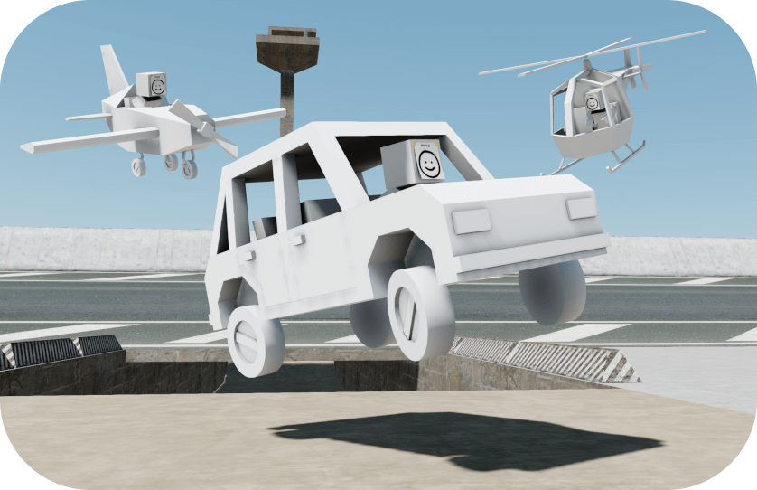

<p align="center">
	
</p>

# Sketchfront

Браузерный мультиплеерный шутер от третьего лица (рабочее название). Видение, стек, режимы
и этапы — в [docs/GAME_BRIEF.md](docs/GAME_BRIEF.md).

Основан на [Sketchbook](https://github.com/swift502/Sketchbook) Яна Блахи (MIT): персонаж
с raycast-контроллером, техника (машины, вертолёты, самолёты) и пайплайн карт из Blender.

**Статус:** этап M0 — песочница Sketchbook перенесена на Vite, TypeScript 5, three.js r186
и cannon-es и работает как раньше.

## Запуск

Нужен Node.js 22.18+.

```sh
npm install
npm run dev        # клиент на http://localhost:5173
npm run build      # продакшен-сборка в packages/client/dist
npm run preview    # раздать собранный клиент
npm run typecheck  # tsc во всех пакетах
npm run server     # заглушка игрового сервера (сеть появится в M3)
```

В dev-режиме мир доступен из консоли браузера как `window.world`.

## Управление

| Клавиша | Действие |
|---|---|
| WASD, Shift, Space | движение, спринт, прыжок |
| ЛКМ / ПКМ | огонь / прицел (вскидывают оружие из-за спины) |
| R | перезарядка |
| 1, 2, 3 или колесо | автомат, дробовик, пистолет |
| Q | сменить плечо камеры |
| F / G | сесть в технику водителем / пассажиром |

Вокруг игрока бродят боты, которые стреляют в ответ. Их число задаётся параметром
адреса: `?bots=10`, а `?bots=0` выключает ботов. В dev-панели Settings → Debug_Navmesh
показывает навигационную сетку.

## Структура

```
packages/
  client/   Vite-приложение: рендер, физика, ввод, UI
    src/        код игры (бывший Sketchbook)
    src/lib/    вендорные dat.gui, stats, шейдеры неба и воды, отладчик физики
    public/assets/  модели .glb, которые грузит клиент
  shared/   общий код клиента и сервера: правила, оружие, режимы, протокол
  server/   авторитетный игровой сервер (пока заглушка)
assets/
  blend/      исходники моделей и карты в Blender
  CREDITS.md  учёт лицензий всех внешних ассетов
docs/
  GAME_BRIEF.md  мастер-документ проекта
tools/        вспомогательные скрипты
```

## Карты из Blender

Объекты в `.glb` несут custom properties, которые читает клиент: `data: physics`
(`type: box|trimesh`), `data: path`, `data: scenario`, `data: spawn`
(`type: player|car|heli|airplane`, `driver: ai|player`, `first_node`).
Расширение схемы для режимов описано в брифе (§8).

## Лицензия

MIT, см. [LICENSE](LICENSE). Авторы и лицензии ассетов — в [assets/CREDITS.md](assets/CREDITS.md).
